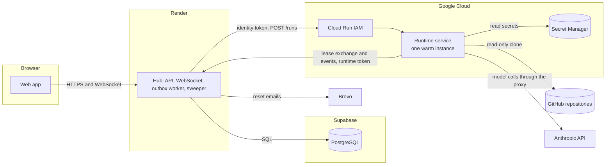
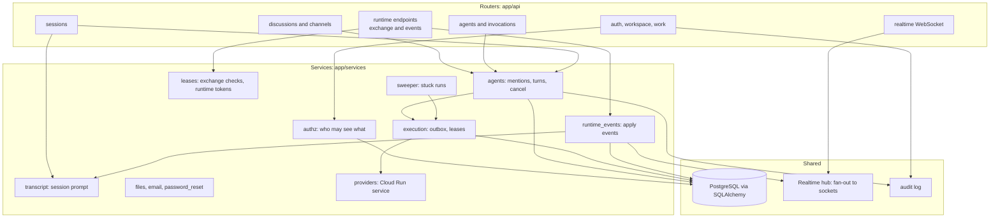
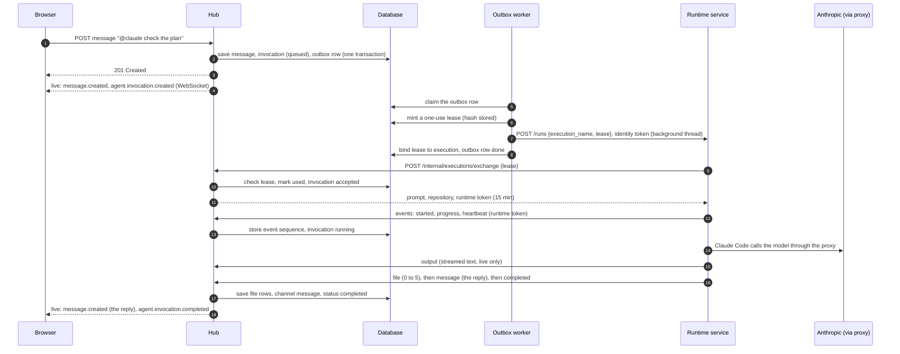
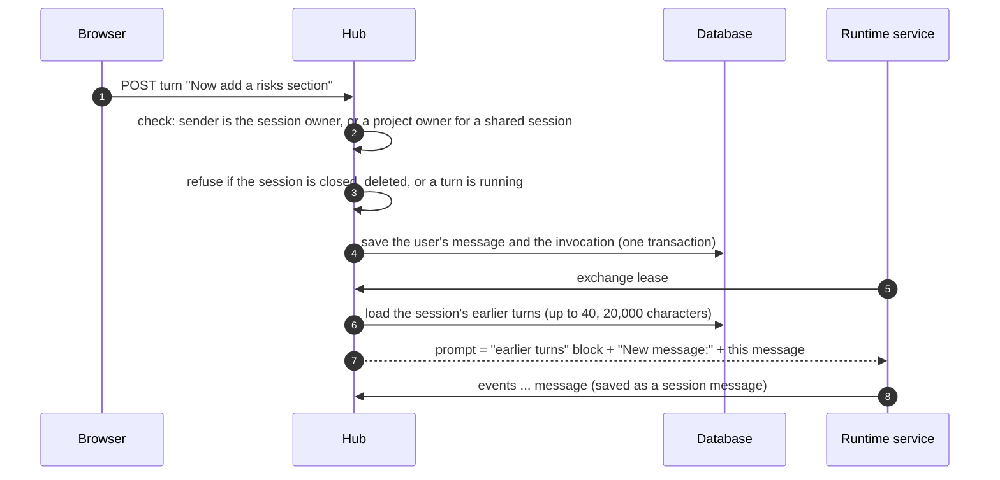
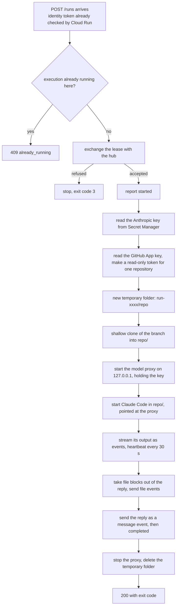
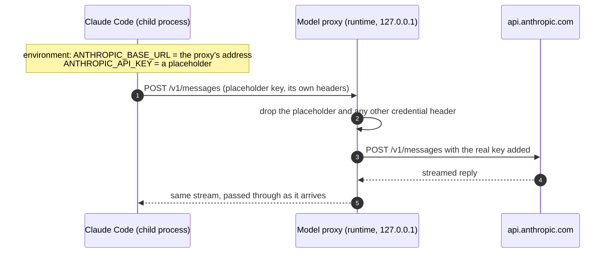
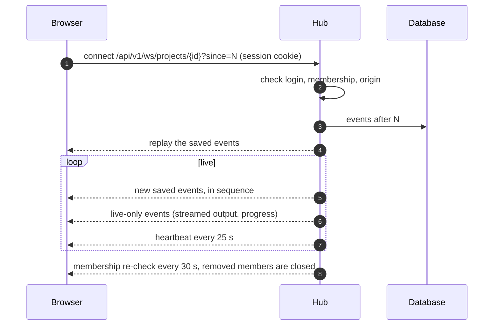
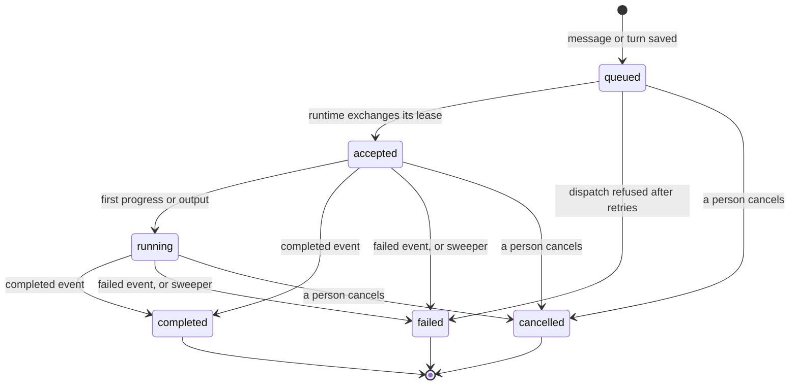

# Architecture

This page explains how the whole system works: what runs where, how a message becomes an agent reply, and exactly what the agent's Claude Code process sees. Diagrams are Mermaid, which GitHub and most Markdown viewers render; the text under each diagram says the same thing.

Each component also has its own page:

- [Backend](components/backend.md): API routes, models, configuration and services
- [Frontend](components/frontend.md): pages, routes and live updates
- [Execution](components/execution.md): the run queue, leases, dispatch and the sweeper
- [Runtime](components/runtime.md): the service that runs an agent, step by step
- [Deployment](deployment.md) and [Security](security.md)

## 1. The pieces

| Piece | Where it runs | What it does |
|---|---|---|
| Browser app | The user's browser, served by the hub | Shows projects, channels, tasks, decisions, agents, sessions, people and activity. |
| Hub | Render web service, one instance | Serves the API, the WebSocket, the web app, the outbox worker and the sweeper. The only part that writes to the database. |
| Database | Supabase PostgreSQL | All state: users, projects, messages, runs, sessions, audit. |
| Runtime service | Google Cloud Run, `collab-agent-runtime-service`, one warm instance | Runs one agent invocation at a time: reads the repository, runs Claude Code, reports back. |
| Model proxy | Inside the runtime process | Holds the Anthropic key and forwards the CLI's API calls. |
| Claude Code CLI | A child process of the runtime, one per run | The agent itself. It reads the repository and writes the reply. |
| Secret Manager | Google Cloud | Holds the Anthropic key and the GitHub App key. |
| GitHub | github.com | The repositories. The runtime reads them through a GitHub App, read-only. |
| Anthropic API | api.anthropic.com | The model. Reached only through the proxy. |
| Brevo | brevo.com | Sends password reset emails. |

Nothing runs on a team member's machine.

## 2. Deployment map



- The hub is one instance. It runs the API, the realtime WebSocket, the outbox worker and the sweeper in one process.
- The runtime service is private. Cloud Run accepts requests only from the hub's dispatcher account.
- Secrets are read by the runtime at run time, with the service's own account. The hub never holds the Anthropic or GitHub key.

## 3. Inside the hub



- **Routers** only parse requests, check the login and call services.
- **authz** is the single place that decides whether a person may see a project, and at what role.
- **agents** creates invocations and session turns. It runs inside the same transaction as the message that caused it.
- **execution** (the outbox) records dispatch work, hands it to the provider, and mints the run's lease.
- **leases** checks a lease when the runtime exchanges it, and issues the runtime token.
- **runtime_events** applies every event a run sends, and publishes the matching live update.
- **transcript** builds the prompt for a session turn from its earlier turns.
- **sweeper** fails runs that stop responding.

## 4. Data model

| Table | What it holds |
|---|---|
| `users`, `auth_sessions`, `password_resets` | Accounts, sign-in sessions (only a hash of each token), and reset links (only a hash, one use). |
| `teams`, `team_memberships` | Teams, and who belongs to them. |
| `projects`, `project_memberships`, `channels` | Projects, roles (owner, admin, member, viewer), and channels. |
| `messages` | Channel messages, from people and from agents. |
| `tasks`, `decisions`, `decision_revisions` | Work items and decisions, with their history. |
| `project_events` | Every change, with a per-project sequence number. Replayed to reconnecting browsers. |
| `audit_events` | Who did what, with no message bodies or credentials. |
| `agents`, `project_agents` | Agents: owner, handle, repository, branch. Which projects each is attached to. |
| `agent_invocations` | One row per run: channel or session, status, prompt, error. |
| `invocation_files` | Up to five text files a run returned, with their content. |
| `agent_sessions`, `agent_session_messages` | Sessions with an agent, their visibility and status, and their transcripts. |
| `execution_outbox` | Work waiting to be dispatched: attempts, retry time, claim lease. |
| `invocation_leases` | One-use run credentials, stored as hashes, bound to the execution. |
| `run_events` | Every event a run sent, by sequence number, to drop duplicates. |

Soft deletion: a session that is deleted keeps its rows, with `deleted_at` set. Every list, page and download hides it.

## 5. A channel mention, end to end



In words:
1. The browser sends the message to the hub. The hub saves the message, an invocation marked `queued` and an outbox row in one transaction, then answers `201`. Nothing has started yet.
2. The worker (inside the hub, every few seconds) picks up the outbox row. It creates a one-use lease for this run and stores only its hash.
3. The worker sends the run to the runtime service, in a background thread so it doesn't wait. The request carries the execution name and the lease, signed with the hub's dispatcher identity.
4. The runtime exchanges the lease for the run's context: the prompt, the repository and a runtime token valid for 15 minutes. The hub marks the lease used and the invocation `accepted`.
5. The runtime reports progress and heartbeats, then runs Claude Code (section 7). Its output arrives as events.
6. The hub stores files and the reply, and pushes each change to open browsers. The reply appears in the channel with no page reload.

## 6. A session turn

A session turn follows the same path, with three differences:



- **Who may send.** The session's owner, and for a shared session also any project owner. Admins and other members can read a shared session but not send to it.
- **The prompt.** The runtime gets the new message together with the session's earlier turns, marked as history, not instructions. The hub builds it at exchange time from the database, so the earlier turns are always current. The stored invocation keeps only the new message.
- **One turn at a time.** A second turn is refused until the first finishes.

The agent does not keep anything between turns. Each turn is a fresh Claude Code process, and the earlier conversation comes back only through the prompt.

## 7. The runtime service, step by step

The service is `python -m collab_runtime serve`. Cloud Run keeps one instance running. The instance handles one request at a time, and each request is one agent run. The exact requests, responses and credentials for each step are in [section 16](#16-the-run-protocol-in-detail).



Step by step:

1. **Receive.** The request must carry an execution name and a lease. If the same execution is already running on this instance, it is refused.
2. **Exchange.** The runtime calls the hub's exchange endpoint with the lease. The hub's checks are in [Execution](components/execution.md#one-use-run-leases). The reply holds the prompt, the repository, the branch and the runtime token.
3. **Start.** The runtime reports `started`. If the agent type is unknown, it reports a failure and stops.
4. **Read the key.** The Anthropic key is read from Secret Manager with the service's own account. It stays in memory.
5. **Read the repository.** The GitHub App key is read, and a token is made that can read one repository. The runtime clones the branch (depth 50, one branch) into a new temporary folder. An empty repository is not an error: the agent is told it has no files.
6. **Start the proxy.** A local proxy starts on a random port on 127.0.0.1, with the key. Section 8 explains it.
7. **Start Claude Code.** The CLI starts in the clone, with the arguments and environment in section 9.
8. **Stream.** Each complete piece of text the agent writes becomes an `output` event. A heartbeat is sent every 30 seconds, so the hub knows the run is alive.
9. **Files.** The runtime takes `<file name="...">` blocks out of the final reply and checks them. Up to five files, at most 100 KB each, with safe names. Each good file is sent as a `file` event.
10. **Reply.** The remaining text is sent as a `message` event, then `completed`. If the agent failed, a `failed` event carries a short code and message.
11. **Clean up.** The proxy stops and forgets the key. The temporary folder, with the clone, is deleted.
12. **Answer.** The HTTP response carries the exit code. The hub's dispatch thread only logs it. The result itself reached the hub as events.

Limits: a run may take 25 minutes (`RUN_TIMEOUT_SECONDS`). The Cloud Run request may last 30 minutes. The runtime writes a timing line for each stage, so you can see where a run's time went.

## 8. The model proxy

The Claude Code process must call the Anthropic API, which needs the key. The key is not given to that process. The runtime runs a small proxy in the same process as the service:



- The proxy forwards only paths that start with `/v1/`. Anything else gets a `404`.
- It never sends the key back to the CLI. Its error replies say only that the model service is unavailable.
- It listens on 127.0.0.1 on a random port. It stops, and forgets the key, when the run ends.
- Only the runtime process holds the key. The CLI's environment contains the proxy's address and the placeholder.

Tested in the Linux runtime image with the real CLI (2.1.322): the proxy added the key to requests, and the CLI itself never had it. The API side was a stand-in during testing, so the real API is confirmed only by production use.

## 9. What the Claude Code process sees

This is the complete picture of what the agent gets in one run.

**Command line** (built in `harness.py`):

```
claude
  --allowedTools Read(//<folder>/**) Glob(//<folder>/**) Grep(//<folder>/**)
  --model claude-haiku-5-5
  -p "<prompt>"
  --output-format stream-json --verbose
```

- `--allowedTools` lists the only tools that run without asking. Each is limited to the run's folder by a rule. The `//` marks an absolute path.
- There is no `Bash`, `Edit` or `Write`, and no network tool. The CLI lists other tools, but they cannot run.
- `-p` runs once, in print mode: it answers the prompt and exits.

**Environment** (the whole environment; nothing is inherited):

| Variable | Value | Meaning |
|---|---|---|
| `PATH` | The runtime's `PATH` | Finds `git` and the CLI. |
| `HOME` | The run's temporary folder | Claude Code keeps its settings and conversation files here, so nothing from an earlier run is visible. |
| `LANG` | `C.UTF-8` | Text encoding. |
| `ANTHROPIC_BASE_URL` | The proxy's address | Where API calls go. |
| `ANTHROPIC_API_KEY` | `held-by-runtime` | A placeholder. The proxy adds the real key. |

**Working folder.** The clone of the agent's branch. Read, Glob and Grep are limited to it.

**Prompt.** The `-p` text is built in this order:
1. The file instructions: the agent cannot write files, returns files as `<file name="…">` blocks, may read PDFs in ranges of 20 pages, and must treat history as history.
2. If the repository is empty: a note that there are no commits and no files, and not to invent code.
3. For a channel mention: the message text.
4. For a session turn: "This message continues a conversation", the earlier turns in `<earlier_turns>`, then `New message:` and this turn's message.

**Built into Claude Code.** The CLI adds its own system instructions and describes its tools to the model. It may also read project memory and settings files in the working folder, such as a `CLAUDE.md` in the repository, and it reads its own settings from `HOME`, which is empty for each run.

**What it can read.** Files under the run's folder: the clone and the reply files it writes. Everything else is refused, including other folders, the process environment and other runs.

**What it can write.** Nothing. The write and edit tools are not allowed.

**What it can reach over the network.** Only the proxy, which forwards `/v1/` to the Anthropic API. The agent's tools cannot reach any other host.

**What leaves the run.** Only what the runtime sends as events: streamed output, file contents, the reply text, and progress or failure messages. Output passes through a redaction step first. Any text shaped like an Anthropic key, or the exact key value, is replaced with `[redacted]`.

**What never reaches the agent.** The Anthropic key, the GitHub App key, the GitHub token, the runtime token, the lease, the database, other people's sessions, and other runs.

## 10. Live updates

Browsers stay connected to the hub over a WebSocket, one per project.



- Saved changes (messages, tasks, decisions, membership, runs, sessions) go into `project_events` with a sequence number, in the same transaction as the change. Reconnecting browsers replay from their last sequence number.
- Live-only changes (streamed text, progress) are sent but not saved. A browser that was disconnected misses them.
- Events about a private session go only to its owner, in replay and live.
- The socket is closed with code 1008 if the origin is not allowed, the login is missing, or the person is not a member.
- The browser sends nothing over the socket. All writes use ordinary requests.

## 11. Run states and timeouts



| Limit | Value | Enforced by |
|---|---|---|
| Lease lifetime | 10 minutes | Hub: a lease must be exchanged within it |
| Runtime token lifetime | 15 minutes | Hub: checked on every event |
| Dispatch attempts | 3, with a short pause | Hub, background thread |
| Start timeout (queued or accepted with no activity) | 15 minutes | Sweeper |
| Heartbeat timeout (running, no activity) | 5 minutes | Sweeper |
| Maximum run length | 40 minutes after creation | Sweeper |
| Agent time limit | 25 minutes (`RUN_TIMEOUT_SECONDS`) | Runtime |
| Service request timeout | 30 minutes | Cloud Run and the hub's HTTP client |
| Heartbeat from the runtime | Every 30 seconds | Runtime |
| Outbox worker interval | 5 seconds by default, 3 in production | Hub |
| Instances | 1 warm, at most 3; one run per instance | Cloud Run |

A cancelled run stops at its next heartbeat, within 30 seconds, when the hub refuses the event with `run_finished`.

## 12. What happens when something fails

| Failure | What happens |
|---|---|
| Hub cannot reach the runtime service | Retried 3 times. If still failing, the sweeper fails the run after 15 minutes with "The agent did not start in time." |
| Exchange refused (lease used, expired, or wrong execution) | The run stops with no events. The sweeper fails it later. |
| Secret cannot be read | `failed` with `secret_unavailable`. The agent is not started. |
| Repository cannot be read | `failed` with the reason from GitHub, shortened and without the token. |
| Agent errors or times out | `failed` with a code. Partial output is already shown. |
| Runtime stops mid-run (instance replaced) | No more events. The sweeper fails the run after about 5 minutes without a heartbeat. |
| Hub restarts mid-run | A run the service already received keeps going, and its events are stored when the hub is back. If the dispatch request had not reached the service, nothing starts, and the sweeper fails the run after 15 minutes. |
| Browser disconnects | It reconnects and replays saved events. Live-only text is missed. |
| Reset email cannot be sent | The request still answers the same way. The operator sees the error in the logs. |

## 13. Trust boundaries

1. **Browser to hub.** Session cookie, CSRF protection on writes, membership checks on every project route.
2. **Hub to runtime service.** Google identity token, checked by Cloud Run; only the dispatcher account can call the service.
3. **Runtime to hub.** One-use lease for the exchange, then a 15-minute token bound to one run.
4. **Runtime to secrets and GitHub.** The service account reads two named secrets; the GitHub token covers one repository and only reads it.
5. **Agent to the rest of the world.** The agent sees only its run folder, and reaches only the model through the proxy. It can write nothing.

The agent is the least trusted party. Repository content is untrusted input to it, so the agent's tools are read-only and confined, and the key is kept out of its process. See [Security](security.md).

## 14. Where to look in the code

| Concern | File |
|---|---|
| Routes | `backend/app/api/` |
| Who may see or do what | `backend/app/services/authz.py`, and the checks in `app/api/sessions.py` |
| Mentions, turns, cancel | `backend/app/services/agents.py` |
| Outbox, dispatch, sweeper | `backend/app/services/execution.py`, `execution_worker.py`, `sweeper.py` |
| Cloud Run dispatch | `backend/app/services/providers/cloud_run_service.py` |
| Leases and runtime tokens | `backend/app/services/leases.py` |
| Applying run events | `backend/app/services/runtime_events.py` |
| Session prompt | `backend/app/services/transcript.py` |
| Live updates | `backend/app/api/realtime.py`, `backend/app/realtime/hub.py` |
| Runtime service and run | `runtime/collab_runtime/service.py`, `main.py` |
| Model proxy | `runtime/collab_runtime/model_proxy.py` |
| Claude Code arguments and environment | `runtime/collab_runtime/harness.py` |
| Clone and tokens | `runtime/collab_runtime/github.py`, `secrets.py` |
| Reply files | `runtime/collab_runtime/reply_files.py` |
| Frontend pages | `frontend/src/pages/` |

## 15. Known limits

- **One hub instance.** The worker, the sweeper, the rate limiter and the realtime fan-out run in one process.
- **One run per runtime instance.** A message that arrives during a run starts a new instance if none is free, which is slower.
- **No conversation memory in the CLI.** Each turn starts a fresh CLI; earlier turns come through the prompt, up to 40 turns and 20,000 characters.
- **The agent cannot write files or change the repository.** Writing to GitHub is planned, and needs separate design (see [Implementation plan](../IMPLEMENTATION_PLAN.md#deferred)).
- **Output is streamed as it is written.** A file's text can show in the stream before the reply is saved without it.

## 16. The run protocol in detail

This section lists every message between the hub, the runtime service and the outside services: what is sent, how it is authenticated, and what comes back. Use it when debugging a run.

### 16.1 Credentials

| Credential | Created by | Format | Lifetime | Sent as | Checked by |
|---|---|---|---|---|---|
| Dispatcher service-account key | Downloaded once from Google Cloud, stored in Render as `GCP_DISPATCHER_KEY` | Service-account JSON, base64-encoded | Until rotated | Never sent; the hub uses it to sign identity tokens | Google |
| Identity token (dispatch) | The hub, for each dispatch, refreshed when it expires | Google-signed token whose audience is the service URL | About one hour | `Authorization: Bearer` on `POST /runs` | Cloud Run IAM, which requires `run.invoker` |
| Run lease | The hub's outbox worker, for each dispatch attempt | Random URL-safe string of 32 bytes (43 characters) | 10 minutes, one use. The hub stores only its SHA-256 | `Authorization: Bearer` on the exchange, and in the dispatch body | The hub: hash match, not revoked, not expired, not used, bound to this execution, repository allowed |
| Runtime token | The hub, when the lease is exchanged | HS256 JWT signed with `RUNTIME_TOKEN_SECRET`. Claims: `sub` = invocation ID, `aud` = `collab-runtime`, `iss` = `collab-hub`, `iat`, `exp` | 15 minutes | `Authorization: Bearer` on every event | The hub: signature, audience, issuer, expiry and subject |
| GitHub App JWT | The runtime, for each run | RS256 JWT signed with the App's private key. Claims: `iss` = App ID, `iat` = now minus 60 s, `exp` = now plus 540 s | About 9 minutes from signing | `Authorization: Bearer` on the token request | GitHub |
| GitHub installation token | The runtime, for each run | Token returned by GitHub, limited to one repository with read-only contents | About one hour | `Authorization: basic` header on git commands (16.7) | GitHub |
| Anthropic API key | Stored in Secret Manager; read by the runtime for each run | `sk-ant-…` key | Until rotated | Added by the proxy as `x-api-key` on each request to Anthropic | Anthropic |
| Secret Manager access | Cloud Run gives the service its account (`agent-runtime`) through the metadata server | Google access token, obtained automatically | Short-lived | Secret Manager API calls | IAM: `secretAccessor` on the two secrets |
| Browser session | The hub, at sign-in | Opaque token in an HttpOnly cookie; the hub stores its hash | 24 hours idle, 14 days in total | Cookie | The hub |
| CSRF token | The hub, as the `ns_csrf` cookie | Random value | Same as the session | `X-CSRF-Token` header on writes | The hub: must match the cookie |

### 16.2 Dispatch: hub to runtime service

```
POST {RUNTIME_SERVICE_URL}/runs
Authorization: Bearer <identity token>
Content-Type: application/json

{"execution_name": "service/<invocation id>/<32 hex characters>",
 "lease": "<43-character lease>"}
```

- **Timeouts:** connect, write and pool 20 seconds each; read 1,800 seconds, because the response comes when the run ends.
- **Retries:** connection errors, `5xx`, `408` and `429` are retried, up to three attempts in all, with pauses of 2 and then 4 seconds. A `409` counts as delivered, because the service already has that execution running. Other `4xx` responses are logged and not retried.
- **What Cloud Run checks first:** the identity token's signature and audience, and that the caller has `run.invoker` on the service. Anything else is refused before the request reaches the runtime.
- **Response when the run ends:** `200 {"exit_code": <n>}`.
- **Service errors:** `400 {"detail": "invalid_request"}` for missing fields, bad JSON or a body over 16 KB; `409 {"detail": "already_running"}`; `404` for other paths.

The dispatch request runs in a background thread, so the hub's worker does not wait for the run.

### 16.3 Exchange: runtime to hub

```
POST {HUB_BASE_URL}/api/v1/internal/executions/exchange
Authorization: Bearer <lease>
Content-Type: application/json

{"execution_name": "<the execution name from the dispatch>"}
```

Success, `200`:

```json
{
  "invocation_id": "<uuid>",
  "prompt": "<the message, or for a session turn the transcript followed by the message>",
  "agent_handle": "claude",
  "harness": "claude_code",
  "runtime_token": "<HS256 JWT, 15 minutes>",
  "runtime_expires_in": 900,
  "repository": "owner/name",
  "ref": "main"
}
```

`repository` and `ref` are `null` for an agent without a repository.

Refusals, with the body `{"detail": "<code>"}`:

| Status | Codes | Meaning |
|---|---|---|
| 401 | `invalid_lease`, `lease_revoked`, `lease_expired` | The lease is unknown, replaced by a newer attempt, or too old. |
| 409 | `lease_used` | The lease was already exchanged. |
| 409 | `run_not_active` | The invocation has already finished. |
| 409 | `execution_not_bound` | The hub has not recorded the execution yet. The runtime treats this as a refusal. |
| 409 | `execution_mismatch` | The execution name is not the one the lease was bound to. |
| 409 | `repository_not_allowed` | The repository is not on `GITHUB_ALLOWED_REPOS`. Refused before the lease is used. |

On success the hub marks the lease used and the invocation `accepted`. A refusal stops the run with exit code 3, and nothing is reported, because there is no runtime token to report with.

### 16.4 Events: runtime to hub

```
POST {HUB_BASE_URL}/api/v1/internal/executions/events
Authorization: Bearer <runtime token>
Content-Type: application/json

{"sequence": 3, "type": "output", "text": "..."}
```

| Type | Fields | Limits |
|---|---|---|
| `started` | none | |
| `progress` | `text`: a stage line | 20,000 characters |
| `heartbeat` | none | Sent every 30 seconds, the first at 30 seconds, until the run finishes |
| `output` | `text`: a complete piece of the agent's text | 20,000 characters, redacted |
| `file` | `name`, `content` | Name: letters, digits, dots, dashes and underscores, starting with a letter or digit, up to 120 characters. Content: up to 100,000 characters |
| `message` | `text`: the reply | 20,000 characters |
| `completed` | none | |
| `failed` | `code`, `message` | Code up to 60 characters, message up to 500 |

Responses:

| Status | Body | Meaning |
|---|---|---|
| 200 | `{"duplicate": false}` | Stored and applied. |
| 200 | `{"duplicate": true}` | This sequence number was already stored. Nothing changes. |
| 401 | `{"detail": "invalid_runtime_token"}` | Missing, wrong, expired, or for another invocation. |
| 404 | `{"detail": "run_not_found"}` | No such invocation. |
| 409 | `{"detail": "run_finished"}` | The run has ended. The runtime stops the agent. |
| 422 | validation error | A field is missing, too long or does not match its rule. |

Sequence numbers start at 0 and go up by one. The runtime counts a sequence only after a successful send, so a retry sends the same number again, and the hub drops the duplicate.

Retries: a connection error or `5xx` is retried, up to three attempts in all, with pauses of 2 and then 4 seconds. A `4xx` is not retried: the run stops at once with exit code 4. If every attempt fails, the run also stops with exit code 4.

What the hub does with each event:
- Records the sequence number and type in `run_events`, for every event, including heartbeats.
- `started`, `progress`, `output` and `heartbeat` update the run's activity time. `progress` and `output` are published live, and their text is not saved.
- `file` saves the file, up to five per run. A repeated name or a sixth file is ignored.
- `message` saves the reply as a channel message or as a session message, and publishes it.
- `completed` and `failed` set the final status, and publish the change.

### 16.5 Model calls: Claude Code to proxy to Anthropic

Claude Code sends ordinary Messages API requests to `ANTHROPIC_BASE_URL`, which is the proxy:

```
POST http://127.0.0.1:<port>/v1/messages
x-api-key: held-by-runtime        (a placeholder)
<the CLI's other headers and JSON body, unchanged>
```

The proxy:
1. Refuses any path that does not start with `/v1/`, with `404`.
2. Drops the CLI's `authorization`, `x-api-key`, `host`, `content-length`, `connection`, `accept-encoding` and `transfer-encoding` headers.
3. Adds `x-api-key: <the real key>`.
4. Sends the request to `https://api.anthropic.com` with the same path and body, and streams the response back as it arrives. Its headers are passed on except `content-length`, `transfer-encoding`, `connection` and `content-encoding`.
5. On a connection failure, answers `502 {"detail": "model service unavailable"}`, with nothing about the request.

### 16.6 Reading the CLI's output

The runtime reads the CLI's standard output one line at a time, as JSON:
- An `assistant` line: its text blocks are joined. The text is redacted and sent as an `output` event.
- A `result` line: its `result` field becomes the final text. Its `is_error` flag, or a subtype other than `success`, makes the run a failure.
- Any other line is ignored.

Output is capped at 1,000,000 bytes. After the cap, the runtime sends one notice, `[output truncated: limit reached]`, and drops the rest. The CLI's error output is kept in a temporary file, and only its last 300 characters are used on failure, after redaction. The CLI is stopped if it runs past `RUN_TIMEOUT_SECONDS` (default 1,500), with the code `timeout`.

### 16.7 Repository: runtime to GitHub

1. **Token request**

   ```
   POST https://api.github.com/app/installations/{installation id}/access_tokens
   Authorization: Bearer <GitHub App JWT>
   Accept: application/vnd.github+json
   X-GitHub-Api-Version: 2022-11-28

   {"repositories": ["<repository name>"], "permissions": {"contents": "read"}}
   ```

   The expected answer is `201` with `{"token": "..."}`. Anything else is a refusal.

2. **Probe** (`git ls-remote`). An empty result means the repository has no commits. That is not an error: the run goes on, and the agent is told there are no files.
3. **Clone** (`git clone --depth 50 --single-branch --branch <ref> https://github.com/<owner>/<repo>.git <folder>`). The token is sent as a header, `http.extraHeader=Authorization: basic base64("x-access-token:<token>")`. The credential helper and the askpass program are disabled, terminal prompts are off, and the command times out after 120 seconds. Error text is cleaned of the token before it is used.

### 16.8 Secrets: runtime to Secret Manager

The runtime reads `projects/<GCP_PROJECT_ID>/secrets/anthropic-api-key/versions/latest` and `projects/<GCP_PROJECT_ID>/secrets/github-app-key/versions/latest`, with the credentials of the service account. The value is decoded as UTF-8 and stripped of surrounding whitespace. It is kept in memory only.

### 16.9 Requests the service accepts

| Path | Method | Response |
|---|---|---|
| `/runs` | `POST` | Described in 16.2 |
| `/healthz` | `GET` | `200 {"status": "ok"}` |
| any other | any | `404` |

The service never logs request bodies, because they contain the lease. It logs the method and path only.
